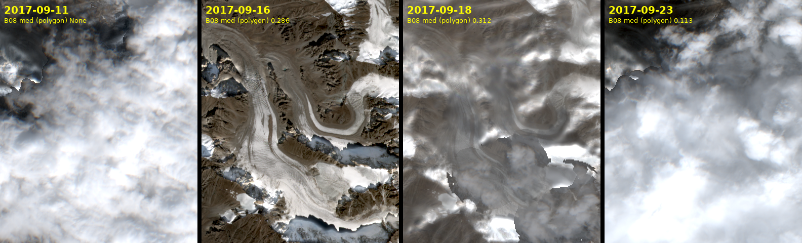
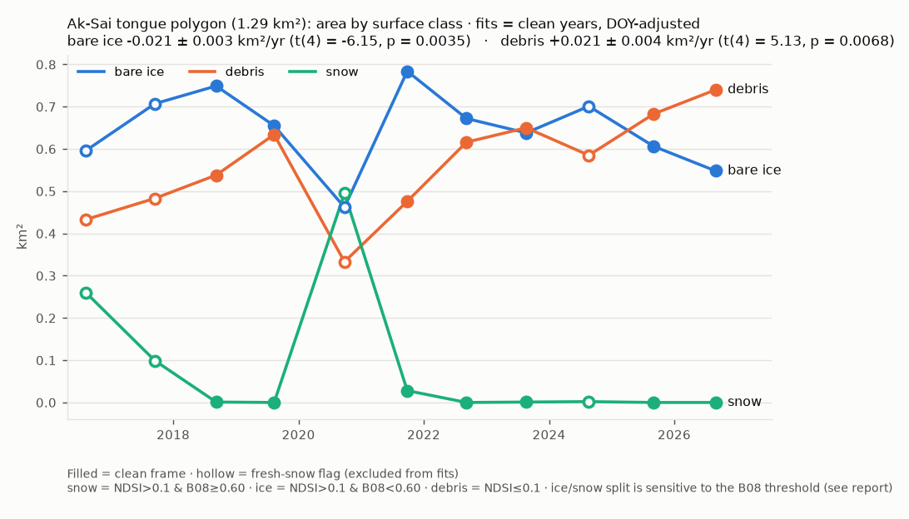
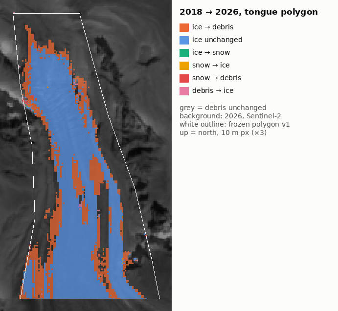
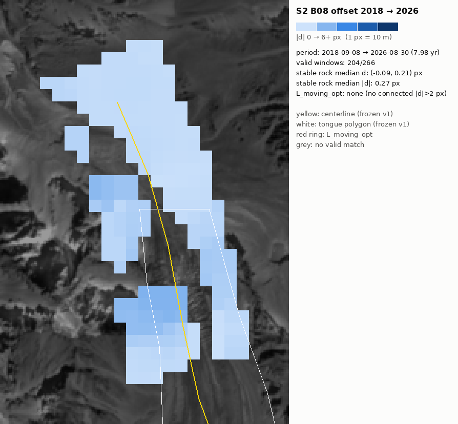
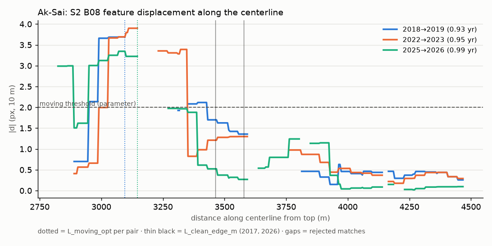
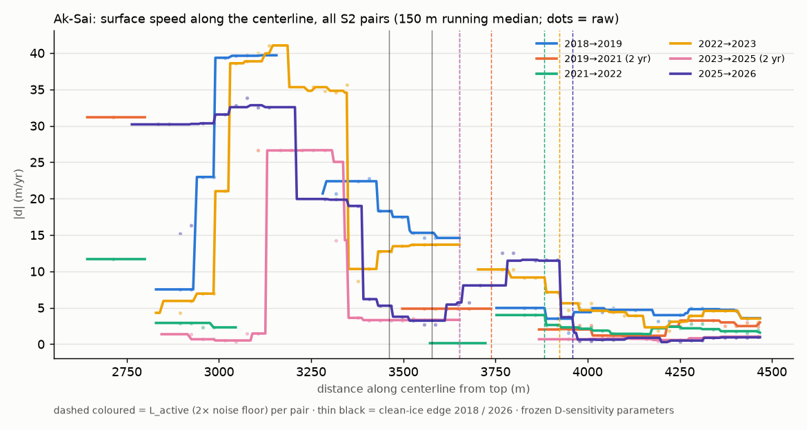
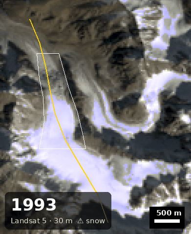
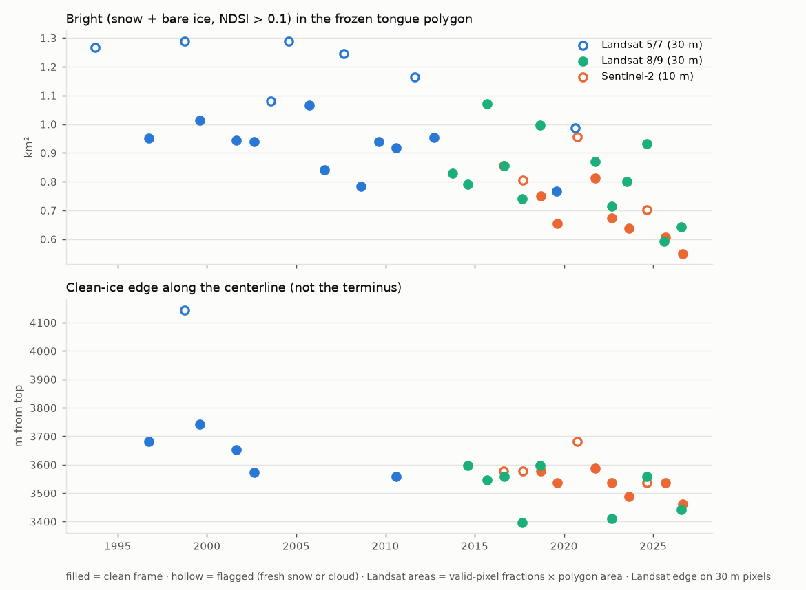
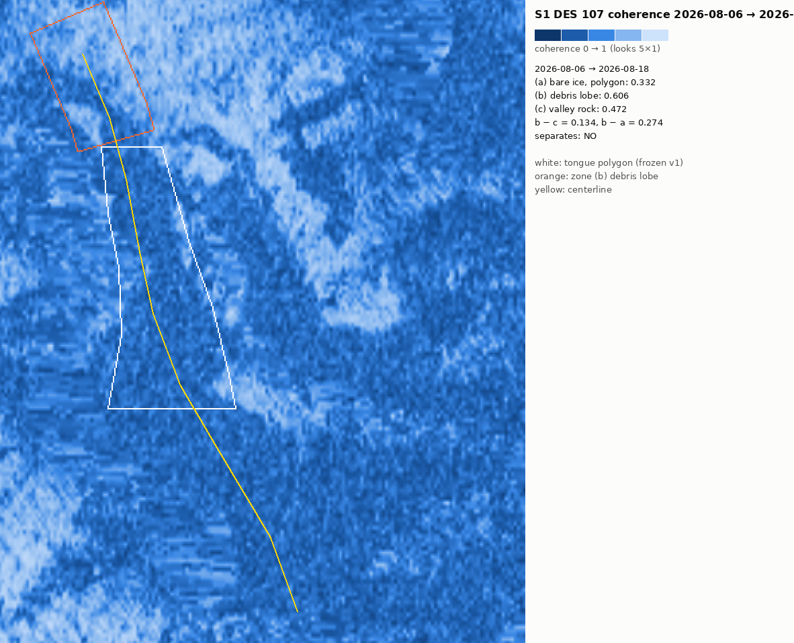

# AKSAY_BASELINE — Ak-Sai glacier, Sentinel-2 2016–2026 (rev6)

R&D mini-project (`aksay/`), independent of OilRadar. Frozen geometry: `aksay_geometry.json` v1, `aksay_tongue_polygon.json` v1 (untouched). **Base year: 2018** (changed from 2017 by rule C3, see Part C).

rev6: Part H — Landsat 1993–2026 joined to the S2 series (30-year baseline). rev5: Part E (is the day-of-year covariate justified), Part G (report corrections), Part F (migration of the active-ice limit). rev4 parts C, D, B-pilot kept. Frozen D-sensitivity parameters.

## Verdict

1. **2017 was fresh snow, not bright ice.** On common clear tongue pixels B08 rose from 0.217 (2017-09-03) to 0.310 (2017-09-16) across a fully overcast 2017-09-11; no B08 ≥ 0.5 area existed on 09-03. → 2017 flagged, base year 2018. The flag rests on an independent signal (dark before the cloudy spell, bright after), not on its effect on the fit. Caveat: the brightening is confined to ice pixels (B08 0.195 → 0.393); debris did not brighten (0.289 → 0.237) — consistent with a thin snowfall that melted off warm debris, but not proof of it.
2. **Bare-ice decline (base 2018, B08 0.60):** clean: -0.021 ± 0.008 km²/yr, t(5) = -2.61, p = 0.048 | clean+DOY: -0.021 ± 0.003 km²/yr, t(4) = -6.15, p = 0.0035. Without the DOY term the evidence is marginal (p ≈ 0.05); with it, strong. B08-split sweep (clean+DOY): 0.50 p = 0.0019, 0.70 p = 0.0057 — no longer split-dependent once 2017 is out.
3. **Debris expansion:** clean: +0.021 ± 0.009 km²/yr, t(5) = 2.28, p = 0.072 | clean+DOY: +0.021 ± 0.004 km²/yr, t(4) = 5.13, p = 0.0068. Without DOY p ≈ 0.07. 27% of 2018 bare ice is debris in 2026, concentrated at the lateral margins.
4. **Optical offset tracking (Part D) — a snapshot of where active ice ends, not a trend (trend: Part F):** the clean, crevassed tongue flows at ~30 m/yr; flow drops to ~4–16 m/yr (pair-dependent) across the clean-ice/debris boundary and fades into the noise at ≈ 3.65–3.96 km along the centerline depending on the pair (Part F). The debris lobe below that is stagnant within noise (< ~0.5 m/yr over 7–8 years). A single L_moving_opt number is **not** stable — reported as a profile, not a rate.
5. **Surface darkening / debris expansion, consistent with thinning.** External check (Hugonnet 2021, RGI60-13.11414): glacier-wide dh/dt 2000–2019 = -0.09 ± 0.17 m/yr — not distinguishable from zero; neither confirms nor rules out tongue thinning.
6. **Sentinel-1 B-pilot (DES 107, 2026-08-06 → 08-18):** coherence bare ice 0.33, debris lobe 0.61, valley rock 0.47 → b − c = 0.13 < 0.15 → stop rule triggered, Part B closed. The lobe is coherent; the rock reference is itself degraded by steep terrain and the 5×1 estimator floor, so b − c understates the contrast to truly stable ground.
7. **30-year baseline (Part H, Landsat 5/7/8/9, one sensor family 1996–2026):** bare ice in the tongue polygon -0.0088 ± 0.0023 km²/yr, t(21) = -3.85, p = 0.00093; clean-ice edge -7.8 ± 2.0 m/yr, t(11) = -3.97, p = 0.0022 — the same direction and size as the S2-only fits, now on 30 years. The tongue was already debris-covered in 1993–1996 (no clean-ice terminus to digitise, H7 not applicable).
8. **Migration of the active-ice limit (Part F): not resolved on 6 pairs.** L_active (2× noise) ranges 305.8 m across pairs with residual SD 130.8 m vs half the fitted change 98.6 m (fit +28.1 ± 22.8 m/yr, t(4) = 1.23, p = 0.28 — not used). Speed under the debris (3600–3950 m) shows no trend: +0.17 ± 0.62 m/yr per yr, t(4) = 0.28, p = 0.79.

## Part E — is the day-of-year covariate justified?

Model clean_doy on the 7 clean years (y = a + b·year + c·(DOY − 240)); the DOY coefficient c:

| series | DOY coefficient (per day) | σ | t | df | p |
|---|---|---|---|---|---|
| tongue_ice_km2 | +0.0033 | 0.0007 | +4.71 | 4 | 0.0082 |
| tongue_debris_km2 | -0.0039 | 0.0008 | -4.87 | 4 | 0.0098 |
| tongue_bright_km2 | +0.0039 | 0.0008 | +4.87 | 4 | 0.0093 |
| tongue_snow_km2 | +0.0005 | 0.0002 | +2.50 | 4 | 0.082 |
| L_clean_edge_m | +1.8133 | 0.6196 | +2.93 | 4 | 0.043 |

**Rule E2:** p(DOY) < 0.10 for ice and debris → the covariate is justified; the Verdict shows both models side by side.
Physical reading: later acquisitions show more bright/ice and less debris area (+0.003 km²/day for ice) — late-season frames carry more residual snow/firn and wetter, brighter ice, so DOY is a confounder, not a nuisance fit. With df = 4 the DOY model is still fragile; both numbers are reported.

## Part C — base-year check (September 2017)

| date | tile CC % | cloud % (bbox, SCL) | snow % (bbox, SCL) | cloud % (polygon) | B08 median, polygon | B08 median, bright px | B08 ≥ 0.5 km² | B08 ≥ 0.6 km² |
|---|---|---|---|---|---|---|---|---|
| 2017-09-03 | 7.5 | 63.6 | 2.6 | 62.9 | 0.217 | 0.195 | 0.0 | 0.0 |
| 2017-09-11 | 17.4 | 91.7 | 0.1 | 100.0 | None | None | 0.0 | 0.0 |
| 2017-09-16 | 0.0 | 0.0 | 23.1 | 0.0 | 0.286 | 0.394 | 0.248 | 0.099 |
| 2017-09-18 | 31.7 | 18.9 | 15.4 | 33.2 | 0.312 | 0.303 | 0.084 | 0.043 |
| 2017-09-23 | 22.4 | 93.9 | 0.2 | 100.0 | 0.113 | None | 0.0 | 0.0 |

- Only five S2 acquisitions in September 2017 (Sentinel-2B not yet routinely acquiring here). Within ±7 days of 09-16: 09-11 and 09-23 fully clouded over the polygon, 09-18 partly clouded/hazy (33 % of polygon).
- Pixels clear on both 09-03 and 09-16: 37% of the polygon; by 2018 class: ice 68%, debris 31% → comparison adequate (≥ 30 % clear, not debris-dominated). On those pixels B08: ice 0.195 → 0.393, debris 0.289 → 0.237 (brightening only on ice).
- The 2017 flag is justified by an independent signal (darker before the overcast spell, brighter after), not by its influence on the fit.
- Same-pixel comparison (pixels clear on both dates): B08 median 0.217 on 09-03 → 0.310 on 09-16; 09-16 → 09-18: 0.276 → 0.312 (haze-affected).
- **Decision (rule C3):** bright B08 0.5–0.6 surface is present only after the 09-11 overcast spell, the pre-storm date is darker → **2017 flagged as fresh snow** (`aksay_flags.json`), **base year → 2018**; all Part A fits and the transition map re-run with 2018.

## Part A (re-run with base 2018) — snow / ice / debris in the tongue polygon

Clean years: 2018, 2019, 2021, 2022, 2023, 2025, 2026 (n = 7). OLS on decimal year; σ = standard error of the slope; two-sided t-test, df = n − p.

| series | model | slope / yr | σ | t | df | p |
|---|---|---|---|---|---|---|
| tongue_ice_km2 | clean | -0.0209 | 0.0080 | -2.61 | 5 | 0.048 |
| tongue_ice_km2 | clean_doy | -0.0208 | 0.0034 | -6.15 | 4 | 0.0035 |
| tongue_ice_km2 | clean_no2021 | -0.0187 | 0.0048 | -3.90 | 4 | 0.018 |
| tongue_ice_km2 | clean_doy_no2021 | -0.0200 | 0.0032 | -6.25 | 3 | 0.0083 |
| tongue_snow_km2 | clean | -0.0006 | 0.0016 | -0.36 | 5 | 0.74 |
| tongue_snow_km2 | clean_doy | -0.0006 | 0.0012 | -0.48 | 4 | 0.65 |
| tongue_debris_km2 | clean | +0.0215 | 0.0094 | +2.28 | 5 | 0.072 |
| tongue_debris_km2 | clean_doy | +0.0214 | 0.0042 | +5.13 | 4 | 0.0068 |
| tongue_bright_km2 | clean | -0.0215 | 0.0094 | -2.29 | 5 | 0.071 |
| tongue_bright_km2 | clean_doy | -0.0214 | 0.0041 | -5.23 | 4 | 0.0064 |
| L_clean_edge_m | clean | -10.6778 | 4.8802 | -2.19 | 5 | 0.08 |
| L_clean_edge_m | clean_doy | -10.6608 | 3.0785 | -3.46 | 4 | 0.026 |

B08 snow/ice split (parameter) sweep:

| B08 | ice, clean | ice, clean + DOY |
|---|---|---|
| 0.50 | -0.0198 ± 0.0061 (t(5) = -3.24, p = 0.023) | -0.0198 ± 0.0027 (t(4) = -7.27, p = 0.0019) |
| 0.60 | -0.0209 ± 0.0080 (t(5) = -2.61, p = 0.048) | -0.0208 ± 0.0034 (t(4) = -6.15, p = 0.0035) |
| 0.70 | -0.0213 ± 0.0091 (t(5) = -2.35, p = 0.066) | -0.0212 ± 0.0039 (t(4) = -5.39, p = 0.0057) |

2021 (2021-09-27): snow 0.028 km², ice 0.784 km² — not snow. Ice without 2021: -0.020 ± 0.003 km²/yr, t(3) = -6.25, p = 0.0083 (clean + DOY).

### Transition map 2018 → 2026

| transition | km² |
|---|---|
| snow (unchanged) | 0.0 |
| snow→ice | 0.0004 |
| snow→debris | 0.001 |
| ice→snow | 0.0002 |
| ice (unchanged) | 0.546 |
| ice→debris | 0.2031 |
| debris→snow | 0.0 |
| debris→ice | 0.002 |
| debris (unchanged) | 0.5362 |

- Lateral margins (outer 20 % of 2018 ice width): 62% of ice→debris vs 40% of all 2018 ice → enriched ≈1.6×.
- Down-glacier quarter: 18% vs 16% baseline → not enriched.
- 86% of ice→debris pixels in connected patches ≥ 50 px → coherent margin/moraine widening, not scatter.

## Part D — optical offset tracking (S2 B08, 10 m)

Method (parameters): NCC 32×32 px windows, 8 px step, ±16 px search, parabolic sub-pixel peak; reject NCC < 0.5 or peak/2nd-peak < 1.3; 3×3 nan-median; ROI ±400 m around the centerline from mid-polygon to 1 km below the polygon (last centerline segment extrapolated for the ROI only). L_moving_opt_m = end of the |d| > 2 px run along the frozen centerline, gaps ≤ 100 m bridged.

### As specified (multi-year pairs, 32 px windows)

| pair | years | valid windows | stable-rock median d (px) | stable-rock median abs d (px) | tongue-polygon median abs d (px) | L_moving_opt_m |
|---|---|---|---|---|---|---|
| 2018→2026 | 7.98 | 204/266 | (-0.09, 0.21) | 0.27 | 0.6 | none |
| 2019→2026 | 7.05 | 195/266 | (0.11, 0.02) | 0.14 | 0.24 | none |

- Co-registration: stable-rock median |d| 0.14–0.27 px < 1 px → no shift applied.
- **Result:** over 7–8 years the crevassed clean-ice tongue decorrelates (matches rejected), so no connected |d| > 2 px run exists → **L_moving_opt undefined with these parameters**. The debris lobe below ≈ 3.8 km matches well (NCC ≈ 0.8) with |d| ≈ 0.1–0.5 px over 7–8 years → stagnant within noise (< ~0.5 m/yr).

### Sensitivity (parameters changed, labelled): annual pairs, 16×16 px windows, 4 px step, ±8 px search

| pair | stable-rock median abs d (px) | 2800–3350 m | 3350–3600 m | 3600–3950 m | 3950–4470 m | L_moving_opt (2 / 1 / 0.5 px, gaps as NaN-stops) | same, NaN-skipping variant |
|---|---|---|---|---|---|---|---|
| 2018→2019 | 0.33 | 29 m/yr | 16 m/yr | 5 m/yr | 4 m/yr | 3095.7 / 3095.7 / 3095.7 | None / None / 3592.5 |
| 2022→2023 | 0.33 | 33 m/yr | 13 m/yr | 9 m/yr | 4 m/yr | None / None / 3592.5 | None / None / None |
| 2025→2026 | 0.1 | 30 m/yr | 4 m/yr | 8 m/yr | 1 m/yr | 3145.9 / 3145.9 / 3145.9 | 3145.9 / 3386.8 / 3467.1 |

- Zone values are medians of |d| along the centerline, ×10 m, per year. Noise floor = stable-rock median |d| ≈ 1–3 m/yr.
- Clean-ice edge L_clean_edge_m: 3577.4 m (2018), 3462.1 m (2026). Motion continues at ~4–16 m/yr (pair-dependent, 1.5–5× the noise floor) for ~300–400 m below it, under debris, and reaches the noise floor at ≈ 3.95 km.
- **Interpretation (strict):** where it moves → ice under debris; where it does not → dead moraine or stagnant (dead) ice. The ≈ 3.95 km point is the limit of *active* ice, not necessarily the terminus — dead ice is still ice.
- **Why no single L_moving_opt rate:** the threshold-based end point jumps between 3.1 and 3.6 km depending on pair, threshold (parameter) and how rejected windows are treated; with 3 annual pairs it cannot carry a trend. Use the velocity profile.
- L_moving_opt vs L_clean_edge: the clean-ice edge is a surface-albedo boundary (bare ice vs debris); active flow extends ≈ 350–450 m further under the debris. They measure different things.

## Part F — migration of the active-ice limit (frozen D-sensitivity parameters)

Pairs on clean frames; 2-year pairs cross a flagged year. |d| normalised to m/yr. QC: stable-rock median |d| ≤ 0.5 px/yr. L_active = last point down-glacier where the 150 m running median of |d| is ≥ k × the pair's noise floor (k = 2, 3: parameters).

| pair | yr | mid | valid windows | noise (m/yr) | QC | L_active 2× (m) | L_active 3× (m) | 2800–3350 | 3350–3600 | 3600–3950 | 3950–4470 (m/yr) |
|---|---|---|---|---|---|---|---|---|---|---|---|
| 2018→2019 | 0.93 | 2019.15 | 828/1065 | 3.55 | pass | 3652.6 | 3652.6 | 31.2 (n=44) | 17.5 (n=49) | 5.0 (n=28) | 4.7 (n=99) |
| 2019→2021 (2 yr) | 2.13 | 2020.67 | 664/1065 | 1.83 | pass | 3737.9 | 2798.9 | 26.7 (n=2) | 4.9 (n=9) | 4.9 (n=21) | 2.4 (n=93) |
| 2021→2022 | 0.94 | 2022.21 | 782/1065 | 1.81 | pass | 3883.2 | 2798.9 | 2.9 (n=20) | 6.7 (n=1) | 2.6 (n=34) | 1.9 (n=89) |
| 2022→2023 | 0.95 | 2023.16 | 860/1065 | 3.47 | pass | 3923.3 | 3652.6 | 35.1 (n=76) | 13.5 (n=49) | 9.2 (n=38) | 3.9 (n=99) |
| 2023→2025 (2 yr) | 2.04 | 2024.65 | 839/1065 | 1.23 | pass | 3652.6 | 3346.7 | 1.5 (n=81) | 3.3 (n=49) | 0.7 (n=5) | 0.8 (n=98) |
| 2025→2026 | 0.99 | 2026.17 | 935/1065 | 1.01 | pass | 3958.4 | 3958.4 | 30.3 (n=81) | 3.8 (n=49) | 8.1 (n=55) | 0.9 (n=91) |

| fit | slope (m/yr per yr) | σ | t | df | p | residual SD | half fitted change over span | resolved |
|---|---|---|---|---|---|---|---|---|
| L_active_2x_m | +28.1 | 22.8 | 1.23 | 4 | 0.28 | 130.8 m | 98.6 m | NO |
| L_active_3x_m | +77.6 | 85.3 | 0.91 | 4 | 0.41 | 489.9 m | 272.4 m | NO |
| zone 3600–3950 speed | +0.17 | 0.62 | 0.28 | 4 | 0.79 | 3.6 m/yr | — | — |

- **Resolvability rule (F5, operationalised):** inter-pair scatter = residual SD around the OLS line; resolvable only if it is ≤ half the fitted change over the 7-year span. Fails for both k → **migration of the active-ice limit is not resolved on 6 pairs; no rate reported.**
- The 3× variant collapses to 2.8 km in two pairs (19→21, 21→22) because the fast clean-ice zone is barely matched there (n = 2 and 20 windows in 2800–3350 m, median 2.9 m/yr in 21→22 vs ~30 m/yr in all other 1-year pairs): 2-year pairs and the late-September 2021 frame decorrelate the crevasse field. The pairs disagree with each other more than any plausible 7-year migration.
- Under-debris zone 3600–3950 m: 0.7–9.2 m/yr across pairs, no trend (p above). No evidence of slowdown on this record.
- Range of L_active (2×) across pairs: 3653–3958 m — the active-ice limit sits ≈ 3.65–3.96 km in every pair, i.e. 100–500 m below the clean-ice edge; that location statement holds, the trend does not.

## Part H — Landsat 1993–2026 (30-year baseline; first clean frame 1996)

**Data.** USGS Landsat Collection-2 Level-2 (Tier 1 only) via Microsoft Planetary Computer, anonymous access. Window Aug–Sep (widened to Jul 15–Oct 10 if needed), scene cloud < 70 %. Scoring inside the bbox: CFMask flags glacier ice as cloud in this terrain, so cloud = high-confidence CFMask cloud with NDSI ≤ 0.4; frames with NDSI > 0.4 on > 60 % of pixels rejected (fresh snow / saturation); same pick rule as S2, non-SLC-off L7 preferred. One frame per year on the S2 bbox at 30 m, upsampled ×3 (nearest) onto the 10 m grid → the frozen polygon and centerline are used unchanged.

**Gaps.** 1990–1992, 1994–1995, 1997, 2000: no usable Tier-1 frame in the window (archive gaps / cloud). Visual QA removed 1998, 2003, 2004, 2007, 2011 (cloud over the tongue). L7 after 2003 has SLC-off stripes: areas are computed as fractions of valid polygon pixels × polygon area; the clean-ice edge skips no-data samples.

**Clean-ice edge QA (parameter):** a 30 m run that breaks before 3000 m along the centerline is a mixed-pixel/stripe failure (every S2 frame has clean ice ≥ 3.3 km) → 'edge not detected'. Detected in 14 of 30 Landsat frames.

| year | sensor | date | valid polygon | bright km² | ice km² | debris km² | clean-ice edge (m) | raw edge (m) | flag |
|---|---|---|---|---|---|---|---|---|---|
| 1993 | L5 | 1993-09-30 | 0.868 | 1.266 | 0.615 | 0.023 | — | 140.7 | auto snow |
| 1996 | L5 | 1996-09-22 | 0.961 | 0.952 | 0.951 | 0.337 | 3682.7 | 3682.7 |  |
| 1998 | L5 | 1998-09-28 | 0.977 | 1.289 | 0.938 | 0.0 | 4144.9 | 4144.9 | cloud (visual QA) |
| 1999 | L7 | 1999-08-06 | 0.903 | 1.013 | 1.013 | 0.276 | 3742.9 | 3742.9 |  |
| 2001 | L7 | 2001-08-20 | 0.85 | 0.944 | 0.944 | 0.345 | 3652.6 | 3652.6 |  |
| 2002 | L7 | 2002-08-23 | 0.899 | 0.938 | 0.938 | 0.35 | 3572.4 | 3572.4 |  |
| 2003 | L7 | 2003-08-01 | 0.578 | 1.08 | 1.08 | 0.209 | — | 140.7 | cloud (visual QA) |
| 2004 | L7 | 2004-08-03 | 0.005 | 1.289 | 1.289 | 0.0 | — | 186.0 | cloud (visual QA) |
| 2005 | L7 | 2005-09-23 | 0.707 | 1.066 | 0.69 | 0.223 | — | 934.3 |  |
| 2006 | L7 | 2006-08-09 | 0.811 | 0.84 | 0.84 | 0.449 | — | 75.4 |  |
| 2007 | L7 | 2007-08-28 | 0.321 | 1.245 | 1.245 | 0.044 | — | 397.1 | cloud (visual QA) |
| 2008 | L7 | 2008-08-14 | 0.82 | 0.783 | 0.783 | 0.505 | — | 1250.4 |  |
| 2009 | L7 | 2009-08-17 | 0.702 | 0.939 | 0.939 | 0.35 | — | 492.6 |  |
| 2010 | L5 | 2010-08-12 | 0.884 | 0.917 | 0.917 | 0.372 | 3557.4 | 3557.4 |  |
| 2011 | L5 | 2011-08-15 | 0.783 | 1.165 | 1.039 | 0.124 | — | 2501.4 | cloud (visual QA) |
| 2012 | L7 | 2012-09-26 | 0.731 | 0.954 | 0.73 | 0.335 | — | — |  |
| 2013 | L8 | 2013-10-07 | 0.901 | 0.828 | 0.828 | 0.461 | — | — |  |
| 2014 | L8 | 2014-08-07 | 0.886 | 0.79 | 0.79 | 0.499 | 3597.5 | 3597.5 |  |
| 2015 | L8 | 2015-09-11 | 0.817 | 1.071 | 0.909 | 0.218 | 3547.4 | 3547.4 |  |
| 2016 | S2 | 2016-08-09 | 1.0 | 0.856 | 0.596 | 0.433 | 3577.4 | — | flagged (S2 pipeline) |
| 2016 | L8 | 2016-08-28 | 0.84 | 0.856 | 0.856 | 0.433 | 3557.4 | 3557.4 |  |
| 2017 | S2 | 2017-09-16 | 1.0 | 0.806 | 0.707 | 0.483 | 3577.4 | — | flagged (S2 pipeline) |
| 2017 | L8 | 2017-08-31 | 0.907 | 0.741 | 0.741 | 0.548 | 3396.9 | 3396.9 |  |
| 2018 | S2 | 2018-09-08 | 1.0 | 0.751 | 0.749 | 0.538 | 3577.4 | — |  |
| 2018 | L8 | 2018-09-03 | 0.758 | 0.997 | 0.982 | 0.292 | 3597.5 | 3597.5 |  |
| 2019 | S2 | 2019-08-12 | 1.0 | 0.655 | 0.655 | 0.634 | 3537.3 | — |  |
| 2019 | L7 | 2019-07-28 | 0.785 | 0.766 | 0.766 | 0.523 | — | 1039.7 |  |
| 2020 | S2 | 2020-09-25 | 1.0 | 0.956 | 0.462 | 0.333 | 3682.7 | — | flagged (S2 pipeline) |
| 2020 | L7 | 2020-08-15 | 0.74 | 0.988 | 0.616 | 0.3 | — | 140.7 | auto snow |
| 2021 | S2 | 2021-09-27 | 1.0 | 0.812 | 0.784 | 0.476 | 3587.5 | — |  |
| 2021 | L8 | 2021-09-27 | 0.835 | 0.87 | 0.87 | 0.419 | — | — |  |
| 2022 | S2 | 2022-09-07 | 1.0 | 0.673 | 0.672 | 0.616 | 3537.3 | — |  |
| 2022 | L9 | 2022-09-06 | 0.903 | 0.714 | 0.714 | 0.575 | 3411.9 | 3411.9 |  |
| 2023 | S2 | 2023-08-21 | 1.0 | 0.638 | 0.638 | 0.65 | 3487.2 | — |  |
| 2023 | L8 | 2023-07-15 | 0.808 | 0.801 | 0.801 | 0.488 | — | 2501.4 |  |
| 2024 | S2 | 2024-08-20 | 1.0 | 0.703 | 0.701 | 0.585 | 3537.3 | — | flagged (S2 pipeline) |
| 2024 | L9 | 2024-08-26 | 0.862 | 0.932 | 0.626 | 0.357 | 3557.4 | 3557.4 |  |
| 2025 | S2 | 2025-09-04 | 1.0 | 0.606 | 0.606 | 0.683 | 3537.3 | — |  |
| 2025 | L9 | 2025-08-13 | 0.913 | 0.592 | 0.592 | 0.697 | — | 1546.3 |  |
| 2026 | S2 | 2026-08-30 | 1.0 | 0.549 | 0.548 | 0.74 | 3462.1 | — |  |
| 2026 | L9 | 2026-07-31 | 0.861 | 0.642 | 0.642 | 0.647 | 3442.0 | 3442.0 |  |

### Fits (clean frames; OLS on decimal year; two-sided t-test)

| series | Landsat 1996–2015 | Landsat 1996–2026 | S2 2018–2026 | Landsat ≤ 2015 + S2 | same, with sensor offset |
|---|---|---|---|---|---|
| ice_km2 | -0.0079 ± 0.0042 km²/yr, t(11) = -1.86, p = 0.09 (n = 13) | **-0.0088 ± 0.0023 km²/yr, t(21) = -3.85, p = 0.00093 (n = 23)** | -0.0209 ± 0.0080 km²/yr, t(5) = -2.61, p = 0.048 (n = 7) | -0.0121 ± 0.0021 km²/yr, t(18) = -5.85, p = 1.5e-05 (n = 20) | -0.0093 ± 0.0036 km²/yr, t(17) = -2.54, p = 0.021 (n = 20); offset -0.063 |
| bright_km2 | -0.0039 ± 0.0045 km²/yr, t(11) = -0.86, p = 0.41 (n = 13) | **-0.0085 ± 0.0026 km²/yr, t(21) = -3.34, p = 0.0031 (n = 23)** | -0.0215 ± 0.0094 km²/yr, t(5) = -2.29, p = 0.071 (n = 7) | -0.0134 ± 0.0026 km²/yr, t(18) = -5.24, p = 5.5e-05 (n = 20) | -0.0057 ± 0.0040 km²/yr, t(17) = -1.42, p = 0.17 (n = 20); offset -0.170 |
| debris_km2 | +0.0039 ± 0.0045 km²/yr, t(11) = 0.86, p = 0.41 (n = 13) | **+0.0085 ± 0.0026 km²/yr, t(21) = 3.34, p = 0.0031 (n = 23)** | +0.0215 ± 0.0094 km²/yr, t(5) = 2.28, p = 0.072 (n = 7) | +0.0134 ± 0.0026 km²/yr, t(18) = 5.24, p = 5.5e-05 (n = 20) | +0.0057 ± 0.0040 km²/yr, t(17) = 1.42, p = 0.17 (n = 20); offset +0.170 |
| L_clean_edge_m | -7.3 ± 2.8 m/yr, t(5) = -2.62, p = 0.047 (n = 7) | **-7.8 ± 2.0 m/yr, t(11) = -3.97, p = 0.0022 (n = 13)** | -10.7 ± 4.9 m/yr, t(5) = -2.19, p = 0.08 (n = 7) | -6.0 ± 1.1 m/yr, t(12) = -5.26, p = 0.0002 (n = 14) | -7.8 ± 2.1 m/yr, t(11) = -3.62, p = 0.0041 (n = 14); offset +40.329 |

**Sensor calibration (H5)** — same-year clean pairs Landsat 8/9 vs S2, years [2018, 2021, 2022, 2023, 2025, 2026]: ice L − S2 = +0.101 ± 0.087 km² (SD), bright +0.098 ± 0.093 km², clean-ice edge -42 ± 75 m (n = 3). Landsat reads ~0.1 km² more ice (mixed 30 m pixels at strip edges, different acquisition dates). There is no L8–S2 overlap before 2016, so the calibration uses 2018–2026.

**Reading.** The headline is the single-sensor-family Landsat fit 1996–2026 (first clean frame 1996) (no cross-sensor splice): bare ice in the polygon declines and the clean-ice edge moves up-glacier at ≈ 8 m/yr (≈ 240 m over 30 years, 8 pixels at 30 m — resolvable over 25+ years as expected, not year-to-year). Naive Landsat + S2 splices inflate the trend because S2 reads less ice than Landsat; with a sensor-offset term the combined fits agree with Landsat-only. Landsat ≤ 2015 alone is weaker (fewer, noisier frames: ice p = 0.09, edge p = 0.047).

- **H7:** already in 1993–1996 the lower tongue is debris-covered with the same lobe below; the terminus was not clean ice in the 1990s, so there is no clean-ice front to digitise. The measurable signal is the clean-ice edge and the bare-ice area, as above.
- Not a terminus or volume measurement; DOY not modelled for Landsat (acquisition dates spread Jul–Oct).

## Part B-pilot — Sentinel-1 coherence, one pair (DES 107)

Pair 2026-08-06 → 2026-08-18 (12 days), coherence with 5×1 looks, resampled to the S2 grid.

| zone | pixels | median | IQR |
|---|---|---|---|
| a_bare_ice_polygon | 5517 | 0.332 | 0.281–0.387 |
| b_debris_lobe | 6004 | 0.606 | 0.436–0.728 |
| c_valley_rock | 90493 | 0.472 | 0.356–0.645 |

b − c = 0.134, b − a = 0.274. Rule (parameters, read as absolute contrasts): |b−c| ≥ 0.15 and |b−a| ≥ 0.1 (parameters).

**Verdict: 12-day C-band coherence does not separate debris-covered ice from ice-free moraine on a near-stagnant tongue; not pursued.** This is a result, not a failure.

- Stop rule triggered by b − c = 0.134 < 0.15. The lobe is coherent; the rock reference is itself degraded by steep, foreshortened terrain and by the 5×1 estimator floor (≈ 0.3), so b − c understates the contrast to truly stable ground. Consistent with Part D (no measurable motion below ≈ 3.95 km): stagnant debris-covered ice and ice-free moraine are not separable by 12-day coherence.
- Bare ice in the polygon is clearly decorrelated (median 0.33) — the active, melting tongue is visible; the method fails only at the boundary that matters (dead ice vs moraine).
- Processing: CDSE OData (SH OAuth token accepted for download), IW3 VV only (2 × 1.35 GB), POEORB from ESA STEP, Copernicus GLO-30 + EGM2008 undulation −37.2 m → WGS84, ISCE2 2.6.5 topsApp (no ESD, no unwrapping), geocoded and resampled to the S2 grid; ≈ 5 min ISCE time. Logs: `aksay/data/s1_pilot/`.
- The 9-year S1 series was **not** downloaded (brief B5).

## Frames

| year | date | cloud % in bbox | snow % in bbox | flag |
|---|---|---|---|---|
| 2016 | 2016-08-09 | 0.32 | 37.1 | auto snow fraction |
| 2017 | 2017-09-16 | 0.0 | 23.1 | manual (aksay_flags.json) |
| 2018 | 2018-09-08 | 0.0 | 24.5 |  |
| 2019 | 2019-08-12 | 0.0 | 20.5 |  |
| 2020 | 2020-09-25 | 0.0 | 31.8 | auto snow fraction |
| 2021 | 2021-09-27 | 0.0 | 24.1 |  |
| 2022 | 2022-09-07 | 0.0 | 21.5 |  |
| 2023 | 2023-08-21 | 0.0 | 20.4 |  |
| 2024 | 2024-08-20 | 0.01 | 31.1 | auto snow fraction |
| 2025 | 2025-09-04 | 0.0 | 17.9 |  |
| 2026 | 2026-08-30 | 0.0 | 15.0 |  |

## Next steps

- Landsat done (Part H). Remaining free-data option: manual digitising of the debris-covered snout on the best Landsat/S2 frames (±30–50 m) for a terminus estimate over 30 years.
- DEM differencing: not pursued — no free post-2016 DEM over the site; on free data it would only reproduce Hugonnet 2021.

## Caveats

- n = 7 clean frames; DOY models have df = 4. p-values assume independent Gaussian residuals — indicative.
- Thresholds are parameters: NDSI 0.1 (tongue), B08 0.60 (snow/ice, swept), offset-tracking NCC/peak-ratio/window/threshold (sensitivity shown), coherence contrasts 0.15/0.10.
- `L_clean_edge_m` = clean-ice/debris boundary on the centerline; not the terminus.
- Hugonnet 2021 via OGGM per-glacier file (`aksay/data/hugonnet_aksay.json`).

## Files

`aksay/out/aksay_metrics.csv`, `aksay_metrics.png`, `aksay_transition_*_2026.png`, `rev3_stats.json`, `c2017_table.json`, `c2017_quicklooks.png`, `offset/`, `offset_win16_annual/`, `f_migration/`, `h_landsat/`, `c2017_g1.json`, `s1_pilot_*`. Re-run offline: `python aksay/process.py && python aksay/c_check.py && python aksay/d_offset.py 2018 2026 2019 2026 && python aksay/f_migration.py && python aksay/h_process.py && python aksay/report_rev6.py`.
