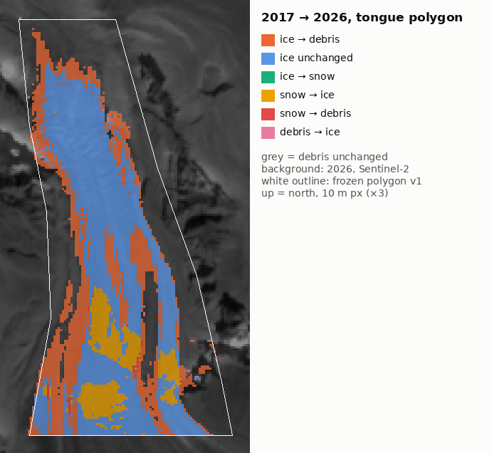
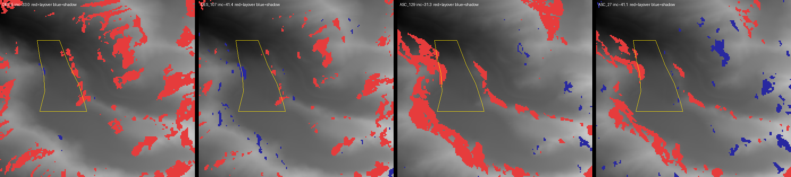

# AKSAY_BASELINE — Ak-Sai glacier, Sentinel-2 2016–2026 (rev3)

R&D mini-project (`aksay/`), independent of OilRadar. S2 L2A via CDSE Sentinel Hub, 10 m. Frozen geometry: `aksay_geometry.json` v1, `aksay_tongue_polygon.json` v1 (untouched in rev3). Base year 2017.

**rev3 changes:** tongue pixels split into snow / ice / debris; t-tests with p-values replace σ-multiples; B08 split swept; 2017→2026 transition map; external check against Hugonnet et al. 2021. Part B (Sentinel-1 coherence) — see last section.

## Verdict

1. **Debris expansion on the tongue — robust.** Debris (NDSI≤0.1) inside the 1.29 km² polygon: 0.483 km² (2017) → 0.74 km² (2026). Clean years, DOY-adjusted: **+0.020 ± 0.003 km²/yr, t(5) = 6.07, p = 0.0018**; without DOY: +0.023 ± 0.007 km²/yr, t(6) = 3.18, p = 0.019. Does not depend on the B08 split.
2. **Bare-ice decline — significant at the default split, but sensitive to it.** Ice (NDSI>0.1 & B08<0.60), clean + DOY: **-0.015 ± 0.005 km²/yr, t(5) = -3.02, p = 0.029**. B08 sweep (clean + DOY): 0.50 → -0.007 ± 0.009 km²/yr, t(5) = -0.77, p = 0.48; 0.60 → p = 0.029; 0.70 → -0.020 ± 0.003 km²/yr, t(5) = -6.34, p = 0.0014. At 0.50 the trend disappears, because 2017's bright surface (B08 0.5–0.6) is reclassified from ice to snow. B08 alone cannot settle whether that 2017 surface was clean ice or a thin fresh-snow dusting (2017-09-16).
3. **2021 (2021-09-27) does not fall into snow:** snow 0.028 km², ice 0.784 km². Ice fit without 2021 is stronger, not weaker: clean -0.017 ± 0.004 km²/yr, t(5) = -4.37, p = 0.0072; clean + DOY -0.016 ± 0.004 km²/yr, t(4) = -4.06, p = 0.015. Stop condition ("trend collapses without 2021") not triggered.
4. **Interpretation:** surface darkening / debris expansion on the lower tongue, consistent with thinning. Not a measured ice-volume change and not a terminus retreat.
5. **External check (Hugonnet et al. 2021, RGI60-13.11414 = Ak-Sai):** glacier-wide dh/dt 2000–2019 = **-0.09 ± 0.17 m/yr** (2000–09: -0.06 ± 0.34; 2010–19: -0.12 ± 0.32); mass balance -0.08 ± 0.15 m w.e./yr. **Not distinguishable from zero.** It neither confirms nor rules out tongue thinning: it is a glacier-wide mean (accumulation-zone thickening could offset tongue lowering), and the period ends before our 2020–2026 frames. Thinning remains a hypothesis consistent with our data, not an established result.

## Where ice turns into debris (2017 → 2026)

| transition | km² |
|---|---|
| snow (unchanged) | 0.0 |
| snow→ice | 0.0943 |
| snow→debris | 0.0045 |
| ice→snow | 0.0001 |
| ice (unchanged) | 0.4528 |
| ice→debris | 0.2546 |
| debris→snow | 0.0001 |
| debris→ice | 0.0013 |
| debris (unchanged) | 0.4812 |

- 36% of 2017 bare ice is debris in 2026.
- **Lateral margins: enriched.** 63% of ice→debris pixels lie in the outer 20% of the 2017 ice width, vs 42% of all 2017 ice there (≈1.5×).
- **Down-glacier end: not enriched.** 17% of ice→debris in the lowest quarter of 2017 ice vs 16% baseline.
- **Not scattered:** 87% of ice→debris pixels sit in connected patches ≥ 50 px (largest 1337 px ≈ 13.37 km²). Pattern = margins and medial moraines widening inward, not a retreating lower edge.
- snow→ice 0.0943 km²: 2017 snow patches in the upper polygon that are bare ice in 2026.

## Metrics

| year | date | snow km² | ice km² | debris km² | bright km² (rev2 metric) | L_clean_edge_m | snow flag |
|---|---|---|---|---|---|---|---|
| 2016 | 2016-08-09 | 0.26 | 0.596 | 0.433 | 0.856 | 3577.4 | ⚠ |
| 2017 | 2017-09-16 | 0.099 | 0.707 | 0.483 | 0.806 | 3577.4 |  |
| 2018 | 2018-09-08 | 0.001 | 0.749 | 0.538 | 0.751 | 3577.4 |  |
| 2019 | 2019-08-12 | 0.0 | 0.655 | 0.634 | 0.655 | 3537.3 |  |
| 2020 | 2020-09-25 | 0.495 | 0.462 | 0.333 | 0.956 | 3682.7 | ⚠ |
| 2021 | 2021-09-27 | 0.028 | 0.784 | 0.476 | 0.812 | 3587.5 |  |
| 2022 | 2022-09-07 | 0.0 | 0.672 | 0.616 | 0.673 | 3537.3 |  |
| 2023 | 2023-08-21 | 0.001 | 0.638 | 0.65 | 0.638 | 3487.2 |  |
| 2024 | 2024-08-20 | 0.002 | 0.701 | 0.585 | 0.703 | 3537.3 | ⚠ |
| 2025 | 2025-09-04 | 0.0 | 0.606 | 0.683 | 0.606 | 3537.3 |  |
| 2026 | 2026-08-30 | 0.0 | 0.548 | 0.74 | 0.549 | 3462.1 |  |

### All fits (clean years = 2017, 2018, 2019, 2021, 2022, 2023, 2025, 2026; OLS on decimal year; σ = standard error of the slope; two-sided t-test, df = n − p)

| series | model | slope / yr | σ | t | df | p |
|---|---|---|---|---|---|---|
| tongue_ice_km2 | clean | -0.0173 | 0.0065 | -2.64 | 6 | 0.039 |
| tongue_ice_km2 | clean_doy | -0.0151 | 0.0050 | -3.02 | 5 | 0.029 |
| tongue_ice_km2 | clean_no2021 | -0.0167 | 0.0038 | -4.37 | 5 | 0.0072 |
| tongue_ice_km2 | clean_doy_no2021 | -0.0159 | 0.0039 | -4.06 | 4 | 0.015 |
| tongue_snow_km2 | clean | -0.0060 | 0.0036 | -1.64 | 6 | 0.15 |
| tongue_snow_km2 | clean_doy | -0.0051 | 0.0035 | -1.47 | 5 | 0.2 |
| tongue_debris_km2 | clean | +0.0232 | 0.0073 | +3.18 | 6 | 0.019 |
| tongue_debris_km2 | clean_doy | +0.0202 | 0.0033 | +6.07 | 5 | 0.0018 |
| tongue_bright_km2 | clean | -0.0232 | 0.0073 | -3.20 | 6 | 0.019 |
| tongue_bright_km2 | clean_doy | -0.0202 | 0.0033 | -6.19 | 5 | 0.0016 |
| L_clean_edge_m | clean | -10.2120 | 3.7574 | -2.72 | 6 | 0.035 |
| L_clean_edge_m | clean_doy | -8.8928 | 2.6932 | -3.30 | 5 | 0.021 |

### Sensitivity to the snow/ice split (B08 threshold)

| B08 | ice, clean | ice, clean + DOY | snow, clean |
|---|---|---|---|
| 0.50 | -0.0082 ± 0.0087 (p = 0.38) | -0.0073 ± 0.0095 (p = 0.48) | -0.0151 ± 0.0091 (p = 0.15) |
| 0.60 | -0.0173 ± 0.0065 (p = 0.039) | -0.0151 ± 0.0050 (p = 0.029) | -0.0060 ± 0.0036 (p = 0.15) |
| 0.70 | -0.0229 ± 0.0070 (p = 0.017) | -0.0200 ± 0.0032 (p = 0.0014) | -0.0003 ± 0.0003 (p = 0.44) |

Sensitivity to the NDSI threshold (rev2, bright = NDSI>t inside polygon): the decline of bright area appears for t = 0.0, 0.1, 0.2 and 0.4; the debris class is its complement at t = 0.1. This is a parameter-sensitivity check, not an independent confirmation.

## Frames

| year | date | cloud % in bbox | snow % in bbox | snow flag |
|---|---|---|---|---|
| 2016 | 2016-08-09 | 0.32 | 37.1 | ⚠ |
| 2017 | 2017-09-16 | 0.0 | 23.1 |  |
| 2018 | 2018-09-08 | 0.0 | 24.5 |  |
| 2019 | 2019-08-12 | 0.0 | 20.5 |  |
| 2020 | 2020-09-25 | 0.0 | 31.8 | ⚠ |
| 2021 | 2021-09-27 | 0.0 | 24.1 |  |
| 2022 | 2022-09-07 | 0.0 | 21.5 |  |
| 2023 | 2023-08-21 | 0.0 | 20.4 |  |
| 2024 | 2024-08-20 | 0.01 | 31.1 | ⚠ |
| 2025 | 2025-09-04 | 0.0 | 17.9 |  |
| 2026 | 2026-08-30 | 0.0 | 15.0 |  |

Selection, rendering and flags as in rev1/rev2: L2A Aug–Sep, in-bbox SCL scoring, snow flag > 1.25 × median (23.1 %), one stretch for the series. 2015 unavailable. Landsat not used.

## Caveats

- 8 clean frames, one per year; each fit has df = 5–6. p-values assume independent Gaussian residuals; inter-annual surface conditions (late snow, wet ice) violate this partly — treat p as indicative.
- Day-of-year effect is real for debris/bright (p ≈ 0.004): later frames show less debris. Main fits control for it.
- `L_clean_edge_m` is the clean-ice/debris boundary on the centerline, not the terminus; kept for continuity.
- Hugonnet 2021 per-glacier rates via OGGM redistribution (`aksay/data/hugonnet_aksay.json`), RGI60-13.11414 matched by centroid (0.9 km from Ak-Sai mid-glacier; area 3.58 km², 3356–4694 m, Lmax 5.6 km).

## Part B — Sentinel-1 coherence terminus

**B1 done (feasibility probe, `aksay/s1_probe.py`, `aksay/data/s1_probe.json`, `aksay/out/s1_geometry.png`). B2–B5 not run.**

| orbit | incidence | tongue layover / shadow | snout zone layover / shadow | August pairs 2017–2026 |
|---|---|---|---|---|
| DES 5 | 33° | 3.5 % / 0.7 % | 6.5 % / 0 % | 10/10 (12 d; 6 d only 2025) |
| **DES 107** | **41°** | **1.7 % / 2.2 %** | **0.6 % / 0 %** | **9/10 (12 d; no pair 2023)** |
| ASC 129 | 31° | 5.4 % / 0 % | 0 % / 0 % | 10/10 (12 d) |
| ASC 27 | 41° | 4.2 % / 0.4 % | 0 % / 0.2 % | 10/10 (12 d) |

- Layover/shadow from Copernicus DEM GLO-30 + orbit heading + footprint-derived incidence. The tongue is **not** in layover/shadow on any orbit; ascending orbits put a layover band on the west valley wall right along the polygon edge. **Chosen: DES 107** (cleanest tongue and snout); 2023 has no August pair on it → 9 years.
- **6-day pairs do not exist** over Ak-Sai for 2017–2024: Sentinel-1B never acquired IW here, Sentinel-1C only from 2025, 2026 is Sentinel-1D only. The series is therefore uniformly **12-day** (the fallback in the brief) — consistent across years, but 12-day August coherence on melting ice and on wet debris-covered dead ice will be low, so the moving/stagnant contrast may be weak.
- Cost of B2: each IW SLC ≈ 7.8 GB; one sub-swath VV TIFF + annotation ≈ 1.3 GB via CDSE OData Nodes. 18 scenes ≈ 25 GB transfer; ISCE2 `topsApp` (coreg → interferogram → coherence, 5×1 looks, geocode to the S2 grid) ≈ 20–40 min per pair as a GitHub Actions matrix job. Engineering + debugging without local network: several Actions iterations.

## Files

`aksay/out/aksay_metrics.csv`, `aksay/out/aksay_metrics.png`, `aksay/out/aksay_transition_2017_2026.png`, `aksay/out/rev3_stats.json`, GIFs and frames in `aksay/out/`. Re-run offline: `python aksay/process.py`.
