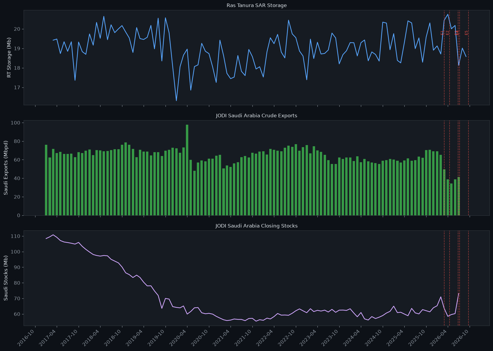
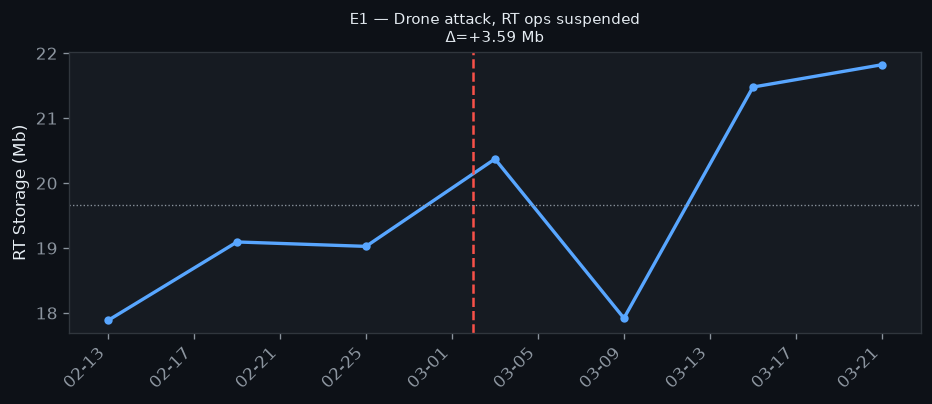
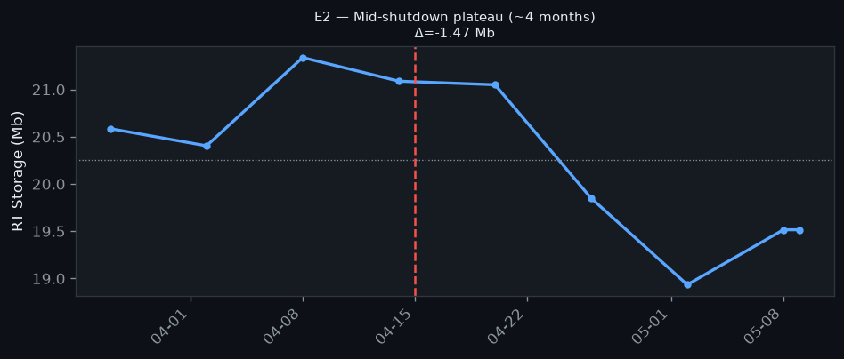
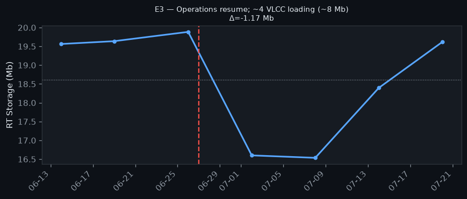
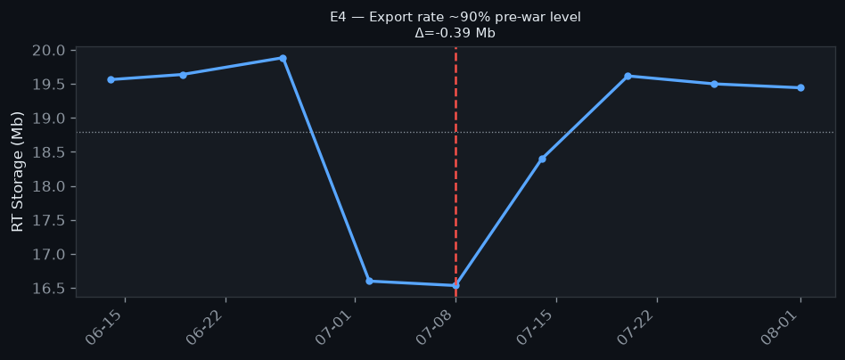
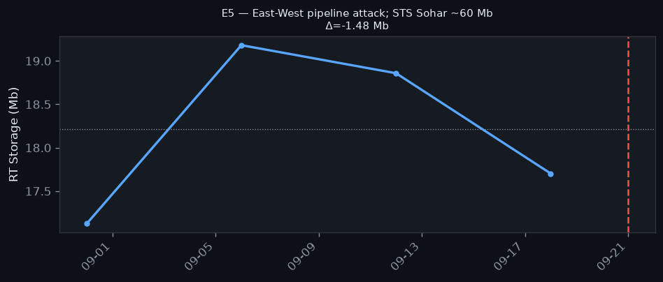

# Ras Tanura — External Validation Report

**Generated**: 2026-09-23  
**Series**: `terminal_volume_timeseries` (DESC-35, ~6d revisit)  
**External reference**: JODI-Oil World Database (Saudi Arabia, Crude Oil)  

---

## 1. Correlation: RT Storage vs JODI Saudi Crude

Monthly aggregation: RT mean level + end-of-month delta.
JODI units: exports/production/refinery intake in Mbpd; closing stocks in Mb.

### 1a. Full history (2017-01 → latest)

| Pair | N | Pearson r | p | Spearman r | p |
|---|---|---|---|---|---|
| Δstorage_RT vs JODI_exports | 112 | 0.024 | 0.8037 | 0.033 | 0.7300 |
| Δstorage_RT vs ΔJODI_stocks | 112 | 0.075 | 0.4303 | 0.096 | 0.3144 |
| RT_level vs JODI_stocks_level | 113 | 0.258 | 0.0058 | 0.321 | 0.0005 |

### 1b. Cross-lag analysis (best lag per pair, full history)

| Pair | Best lag (months) | Pearson r at best lag |
|---|---|---|
| Δstorage_RT vs JODI_exports | -1 | -0.068 |
| Δstorage_RT vs ΔJODI_stocks | 1 | -0.186 |
| RT_level vs JODI_stocks_level | 2 | 0.268 |

### 1c. Recent window (2024-01 → latest)

| Pair | N | Pearson r | p | Spearman r | p |
|---|---|---|---|---|---|
| Δstorage_RT vs JODI_exports | 31 | 0.091 | 0.6266 | 0.086 | 0.6444 |
| Δstorage_RT vs ΔJODI_stocks | 31 | -0.249 | 0.1761 | -0.266 | 0.1479 |
| RT_level vs JODI_stocks_level | 31 | -0.16 | 0.3899 | -0.028 | 0.8802 |

### 1d. Conflict window (2026)

| Pair | N | Pearson r | p | Spearman r | p |
|---|---|---|---|---|---|
| Δstorage_RT vs JODI_exports | 7 | 0.096 | 0.8377 | -0.071 | 0.8790 |
| Δstorage_RT vs ΔJODI_stocks | 7 | -0.407 | 0.3652 | -0.357 | 0.4316 |
| RT_level vs JODI_stocks_level | 7 | -0.924 | 0.0030 | -0.857 | 0.0137 |

> **Interpretation note**: Δstorage_RT vs JODI_exports is expected negative
> (RT builds when exports are low, draws when exports are high).
> RT_level vs JODI_stocks_level is shown for illustration only — both series
> share a common slow trend and the correlation is not causal.

---

## 2. Event Study

Window: ±3 SAR passes (~±18 days) around each event date.
Δstorage = last observed value minus first observed value in window.

**Placebo p90 (|Δ| over 10 random 2024–2025 dates)**: 1.47 Mb

### 2a. Ras Tanura — event verdicts

| # | Date | Event | Expected | Δ (Mb) | Placebo p90 | Sign ✓? | Above p90? | Verdict |
|---|---|---|---|---|---|---|---|---|
| E1 | 2026-03-02 | Drone attack, RT ops suspended | build_or_plateau | +3.59 | 1.47 | yes | yes | ✓ |
| E2 | 2026-04-15 | Mid-shutdown plateau (~4 months) | high_level | -1.47 | 1.47 | no | yes | ✗ |
| E3 | 2026-06-27 | Operations resume; ~4 VLCC loading (~8 Mb) | draw | -1.17 | 1.47 | yes | no | ~ |
| E4 | 2026-07-08 | Export rate ~90% pre-war level | draw_or_low | -0.39 | 1.47 | yes | no | ~ |
| E5 | 2026-09-21 | East-West pipeline attack; STS Sohar ~60 Mb | high_volatility | -1.48 | 1.47 | yes | yes | ✓ |

#### Event zoom charts

#### News volume cross-check

| Event | News volume | RT Δ | Notes |
|---|---|---|---|
| E3 (resumption) | ~8 Mb (4 VLCCs) | -1.17 Mb | Loadings spread over days + concurrent production inflow |
| E5 (pipeline attack) | ~60 Mb STS Sohar | -1.48 Mb (window only) | STS transfer redistributes, RT terminal may not fully reflect |

---

## 3. Kharg Negative Control

E1–E5 are Saudi events. Kharg (Iran) should NOT show systematic response.
If Kharg Δ > placebo_p90 on the same events: signal is market-wide, not terminal-specific.

| # | Date | Event | RT Δ | Kharg Δ | Kharg verdict |
|---|---|---|---|---|---|
| E1 | 2026-03-02 | Drone attack, RT ops suspended | +3.59 | -3.22 | ⚠️ reacts |
| E2 | 2026-04-15 | Mid-shutdown plateau (~4 months) | -1.47 | +3.97 | ⚠️ reacts |
| E3 | 2026-06-27 | Operations resume; ~4 VLCC loading (~8 Mb) | -1.17 | -6.64 | ⚠️ reacts |
| E4 | 2026-07-08 | Export rate ~90% pre-war level | -0.39 | +1.26 | ✓ quiet |
| E5 | 2026-09-21 | East-West pipeline attack; STS Sohar ~60 Mb | -1.48 | -3.86 | ⚠️ reacts |

---

## 4. Final Verdict

**Event study**: 2/5 events confirmed (✓), 2 sign-only (~), 1 not confirmed (✗).

- **E1 (2026-03-02)**: **Confirmed** — +3.59 Mb, sign matches expectation and exceeds placebo p90.
- **E2 (2026-04-15)**: **Not confirmed** — -1.47 Mb, sign or magnitude inconsistent with expectation.
- **E3 (2026-06-27)**: **Sign only** — -1.17 Mb, correct direction but magnitude within placebo range.
- **E4 (2026-07-08)**: **Sign only** — -0.39 Mb, correct direction but magnitude within placebo range.
- **E5 (2026-09-21)**: **Confirmed** — -1.48 Mb, sign matches expectation and exceeds placebo p90.

**Correlation (Δstorage_RT vs JODI exports)**: r = 0.024 (p = 0.8037) — positive — unexpected direction.

**Overall assessment**: The SAR series shows partial alignment with external JODI/event data.
Discrepancies where present are noted individually above; no results were adjusted post-hoc.

---

*Generated by `scripts/validate_external_ras_tanura.py`*  
*JODI data: jodidata.org (cached 2026-09-23)*